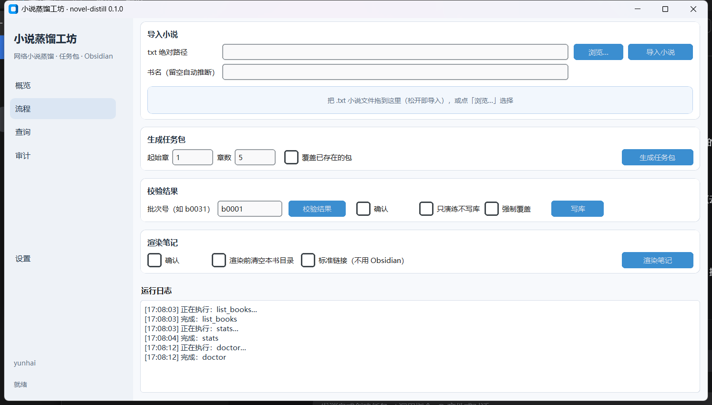
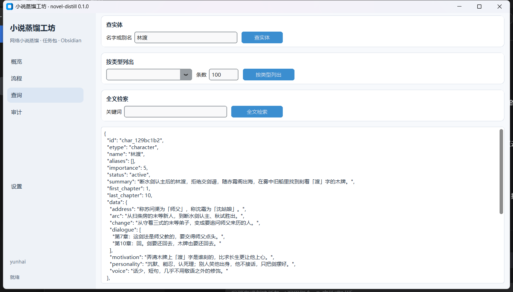

# novel-distill · 网络小说蒸馏工坊

把一部长篇网络小说蒸馏成**每条设定都能回到原文**的结构化设定库：实体、关系、事件、伏笔、章节摘要全部落成 JSONL + SQLite，既能渲染成 Obsidian 双链笔记给人读，也能导出续写上下文包给模型用。

> Novel-Distill turns long web novels into a source-traceable setting library (entities, relations, events, foreshadowing, chapter summaries in JSONL + SQLite), renders it into Obsidian notes, and packs it as a continuation context for LLMs.

[](https://www.python.org/)
[](LICENSE)
[](tests)
[](CHANGELOG.md)
[]()

**免安装**：[Releases](https://github.com/anc233/novel-distill/releases/latest) 提供 Windows x64 便携包（解压后双击 `novel-distill.exe`，无需 Python）。

| 流程页：导入 → 任务包 → 校验 → 入库 → 渲染 | 查询页：按名字查任意实体 |
|---|---|
|  |  |

> 截图为内置桌面 GUI（浅色主题、中英双语），数据来自一段自制演示文本。

---

## 它解决什么问题

长篇网文动辄 2000+ 章、数百万字，塞不进上下文，也没法靠"通读一遍"写设定集；而让模型直接读完再写笔记，得到的是不可核对、不可增量维护的自然语言。

本项目的做法是把这件事拆成三段，**模型只出现在中间一段，且不需要接入任何 API**：

| 段 | 做什么 | 产物 |
|---|---|---|
| **A 语料层** | 编码归一 → 清洗 → 切卷切章 → 体检 | `manifest.json`、`chapters/*.md`、`split-report.md` |
| **B 蒸馏层** | 按批生成抽取任务包 → 外部 LLM 按协议填结果 → 校验 → 幂等入库 | `results/bNNNN.json`、`codex/*.jsonl`、`novel.db` |
| **C 消费层** | 渲染 Obsidian、查询、自检、导出续写上下文包 | `vault/`、CLI 查询结果、`pack-continue` 包 |

B 段刻意不调用模型：`pack` 生成任务包、`validate` 校验结果、`apply` 入库都是纯确定性代码。模型在哪跑、用哪家、用不用模型都行，产物可复现、可重放、可逐批补跑。

## 特性

- **台词有出处**：每条证据都挂 `chapter:cNNNN` 与原文片段，`validate` 会逐字回查片段是否真在该章正文里。
- **协议 + 17 类规则**：结果文件按固定 schema 组织，校验覆盖章节集合、证据引文、关系两端、伏笔状态、事件章号、人物口吻等（V1–V17），error/warning/conflict 分级。
- **幂等入库**：`apply` 单事务写入，重复跑同一批不会重复建卡；冲突（如引用了尚未建卡的角色）能先验后建。
- **可查询**：SQLite + FTS5，`entity` / `list` / `search` / `stats` / `volume` / `chapter` 六种查法，全部支持 `--json`。
- **两种呈现**：默认输出 Obsidian 双链，`--plain-links` 输出标准 Markdown 相对链接，Typora / VSCode 也能用。
- **三种入口**：命令行 20 个子命令、桌面 GUI、MCP server（17 个工具，可给 Claude Code / Cursor / Codex 直接调用）。
- **零强制第三方依赖**：核心只用标准库；分词、模糊匹配、Schema 校验、vault 回读等按需装 extra，缺了就自动降级。

## 安装

需要 Python 3.12+（SQLite 需带 FTS5，官方安装包自带）。Windows 下建议把 Python 装在纯 ASCII 路径。

```powershell
git clone https://github.com/anc233/novel-distill.git
cd novel-distill

# 开发安装，带全部可选依赖（推荐）
pip install -e ".[all]"

# 或只装核心：零第三方依赖，也能完整跑通流水线
pip install -e .
```

可选依赖按需安装，未安装时对应功能自动退回标准库实现：

| extra | 依赖 | 解锁的能力 | 没装时的行为 |
|---|---|---|---|
| `seg` | jieba | 中文分词、词性过滤 | 退化为正则切词，人名候选变糙 |
| `fast` | rapidfuzz | 实体名模糊去重 | 退化为精确匹配 |
| `schema` | jsonschema | 结果文件按 JSON Schema 深度校验 | 只跑手写 V1–V17 规则 |
| `compat` | pypinyin / networkx / python-frontmatter / chardet | 排序、关系图、frontmatter、编码探测增强 | 各自降级 |
| `vault` | obsidiantools | 渲染后回读 vault，校验双链与孤立笔记 | 跳过 vault 校验 |
| `dedup` | datasketch | 近重复章节检测（MinHash+LSH） | 只做精确重复检测 |
| `mcp` | mcp | 内置 MCP server | `mcp` 子命令提示装依赖 |
| `gui` | customtkinter / tkinterdnd2 | 桌面图形界面 | `gui` 子命令提示装依赖 |
| `all` | 以上全部 | — | — |
| `dev` | ruff / pytest / pytest-cov / build / pyinstaller | 开发、测试、打包 | — |

## 快速开始

以你自己的书为例，整条闭环只要几条命令（`my-novel` 是书名标识，随便取）：

```powershell
# 0. 环境自检：Python / FTS5 / workspace 可写 / Obsidian vault / git
python -m novel_distill doctor

# 1. 导入 txt（自动探测编码、清洗、切卷切章）
python -m novel_distill add .\我的小说.txt --slug my-novel --title "我的小说" --author "作者"
python -m novel_distill stats my-novel
python -m novel_distill split-report my-novel          # 看切章是否合理

# 2. 生成抽取任务包（含正文 + 已知设定 + 协议要求）
python -m novel_distill pack my-novel --from 1 --count 5
#    → workspace/my-novel/results/b0001.json

# 3. 把 b0001.json 交给任意 LLM，按包里内嵌的协议填好，存回同路径
python -m novel_distill validate my-novel b0001        # 逐字回查证据、检查关系/伏笔/事件
python -m novel_distill apply    my-novel b0001        # 单事务幂等入库

# 4. 渲染与查询
python -m novel_distill render my-novel                # → <vault>/修仙蒸馏/我的小说/
python -m novel_distill query  my-novel entity 主角名
python -m novel_distill lint   my-novel                # 缺口/冲突/断链/未渲染自检
```

任务包文件名按**起始章号**编号（第 6 章起的 5 章是 `b0006`），方便接着往下批。全流程不联网，也不内置任何模型调用。

续写方向可以用 `pack-continue` 把"最近摘要 + 关键设定 + 原文语感样本"打包成一个上下文文件，直接喂给模型：

```powershell
python -m novel_distill pack-continue my-novel --upto 100 --recent 10
```

## 桌面 GUI

```powershell
python -m novel_distill gui          # 打包后的 exe 双击即进这里
python -m novel_distill gui --self-test   # 只构建界面后退出，用于验证打包
```

侧栏五页：

- **概览**：选书、统计 JSON、环境自检；
- **流程**：拖入 `.txt` 即导入 → 生成任务包 → 校验 → 写库 → 渲染，带运行日志；
- **查询**：查实体 / 按类型列出 / 全文检索；
- **审计**：设定库自检、断链、孤立笔记、近重复章节；
- **设置**：workspace / vault / 语言 / 只读开关，可一键把 MCP 配置写入客户端。

设置存程序同级的 `novel_distill_gui.json`，数据默认也落在程序同级目录，整个文件夹可以整体搬走。

## 接入 MCP（给智能体用）

```powershell
pip install -e ".[mcp]"
python -m novel_distill mcp      # stdio 传输；装了入口后也可直接 novel-distill-mcp
```

客户端配置（Claude Code / Cursor / Codex 等）：

```json
{
  "mcpServers": {
    "novel-distill": {
      "command": "novel-distill-mcp"
    }
  }
}
```

- 共 17 个工具，覆盖导入、任务包、校验、入库、渲染、查询、统计；
- 默认允许写；`apply_result` 与 `render_book` 需要显式 `confirm=true`；
- `NOVEL_DISTILL_READONLY=1` 一键只读；`NOVEL_DISTILL_WORKSPACE` / `NOVEL_DISTILL_VAULT` 做路径隔离。
- 便携版已内置 MCP 依赖：`command` 填 `novel-distill.exe`、`args` 填 `["mcp"]` 即可。

详见 [docs/MCP.md](docs/MCP.md)。

## 命令参考

所有子命令都支持 `--json`（机器可读输出）。退出码：`0` 成功、`2` 校验失败、`3` 数据缺失。

**语料层**

| 命令 | 作用 | 主要参数 |
|---|---|---|
| `init` | 初始化工作区 | `--vault` |
| `doctor` | 环境自检 | `--vault`、`--json` |
| `add <txt>` | 导入一本书并切章 | `--slug`、`--title`、`--author`、`--no-chapters`、`--overwrite`、`--max-heading-len` |
| `split-report <slug>` | 切章报告 | `--markdown`、`--json` |
| `stats <slug>` | 语料统计；`--db` 看设定层与覆盖率 | `--db`、`--write`、`--json` |

**蒸馏层**

| 命令 | 作用 | 主要参数 |
|---|---|---|
| `pack <slug>` | 生成抽取任务包 | `--from`、`--count`、`--force`、`--list` |
| `validate <slug> <batch>` | 校验抽取结果（V1–V17 + 可选 JSON Schema） | `--json` |
| `apply <slug> <batch>` | 校验并入库（单事务幂等） | `--force`、`--dry-run`、`--json` |
| `keywords <slug>` | 抽关键词与新人名候选 | `--from`、`--count`、`--top`、`--write`、`--vault` |

**消费层**

| 命令 | 作用 | 主要参数 |
|---|---|---|
| `render <slug>` | 渲染 vault（或普通 Markdown 目录） | `--vault`、`--clean`、`--plain-links` |
| `query <slug> <kind>` | entity / list / search / stats / volume / chapter | `--type`、`--limit`、`--json` |
| `voice <slug>` | 导出人物口吻卡 | `--min-importance`、`--limit`、`--out`、`--vault` |
| `pack-continue <slug>` | 生成续写上下文包 | `--upto`、`--recent`、`--style-sample` / `--no-style-sample` |

**维护**

| 命令 | 作用 | 主要参数 |
|---|---|---|
| `lint <slug>` | 设定库自检（缺口/冲突/断链/未渲染） | `--vault`、`--no-links`、`--write` |
| `dedup <slug>` | 近重复章节检测 | `--threshold`、`--min-chars`、`--num-perm` |
| `repair-spans <slug>` | 按证据/关系/事件重算实体章号跨度 | `--dry-run` |
| `retype <slug> <name> <etype>` | 改实体类型并重算 ID | `--rebuild`、`--dry-run` |
| `rebuild-db [slug]` | 从 manifest / 分章 / JSONL 重建数据库 | `--all` |
| `mcp` / `gui` | 启动 MCP server / 图形界面 | `gui --self-test`、`gui --lang` |

## 工作区结构

默认 `workspace/`（可用 `NOVEL_DISTILL_WORKSPACE` 改），数据与代码分离：

```
workspace/my-novel/
├── manifest.json           # 书名、作者、卷章目录、字符数、切章告警
├── chapters/               # 每章一个 markdown（c0001.md …）
├── split-report.md         # 切章体检：缺章、重章、超长章
├── results/bNNNN.json      # 抽取任务包（内嵌正文 + 已知设定 + 协议）
└── codex/                  # 入库后的结构化数据
    ├── entities.jsonl      # 实体卡（人物/法宝/功法/宗门/丹方…）
    ├── relations.jsonl     # 关系（两端 + 依据章号）
    ├── evidence.jsonl      # 原文证据（章号 + 片段 + 归属条目）
    ├── appearances.jsonl   # 出场记录
    ├── foreshadowings.jsonl# 伏笔（open / paid）
    ├── events.jsonl        # 事件
    └── summaries.jsonl     # 章节摘要
```

`novel.db` 由上述文件派生，随时可用 `rebuild-db` 重建，不必进版本库。

## 仓库结构

```
novel_distill/
├── cli.py              # 20 个子命令入口
├── service.py          # CLI / MCP / GUI 共用的服务层
├── mcp_server.py       # MCP server（17 个工具）
├── gui/                # CustomTkinter 界面（app / i18n / settings / mcp_connect）
├── config.py           # 路径与工作区约定
├── ingest/             # 编码探测、清洗、切卷切章、关键词
├── tasks/packet.py     # 抽取任务包生成
├── codex/              # 抽取协议、校验（V1–V17）、入库
├── store/              # SQLite schema、repo、JSONL、重建、自检、迁移
├── render/             # Obsidian 渲染、人物口吻卡
├── pack/               # 续写上下文包
├── stats/              # 统计
└── util/               # 中文数字、ID、frontmatter、文本工具
```

另有 `packaging/`（便携版打包入口与 spec）、`tests/`（97 个测试）、`docs/`（设计与接入文档）、`tools/`（测试引导脚本）。

## 打包便携版

需要一个 Python 环境装好依赖，打包结果给没有 Python 的人用：

```powershell
pip install -e ".[all,dev]"
python -m PyInstaller packaging/novel-distill.spec --noconfirm
# → dist/novel-distill/ 整个目录压 zip 分发；解压到含中文或空格的路径也能跑
```

双击 `novel-distill.exe`（无参数）进 GUI，带参数即命令行；`novel-distill.exe mcp` 以 stdio 启动 MCP server，便携包已内置其依赖。spec 用 `SPECPATH` 推仓库根，不含任何本机绝对路径。

## 开发

```powershell
pip install -e ".[all,dev]"
python -m pytest -q                                                # 97 passed
python -m pytest -q --cov=novel_distill --cov-report=term-missing  # 覆盖率 ~80%
python -m novel_distill gui --self-test                            # GUI 冒烟
ruff check novel_distill tests conftest.py                         # lint
python -m build --wheel --sdist
```

约定：核心模块不得在 import 期引入第三方库；可选依赖一律在函数内部导入并 try/except 降级；新增子命令要同时补 `--json` 输出与测试。

## 常见问题

- **Windows + Python 3.14 报 `PermissionError`**：`tempfile.mkdtemp` / `Path.mkdir(mode=0o700)` 会生成带受限 ACL 的目录，pytest 与 pip 都会踩到。仓库根的 `conftest.py` 会自动探测并打补丁，正常跑 pytest 即可。
- **切章不对**：先看 `split-report`；网文的标题格式千奇百怪，可用 `--max-heading-len` 调整标题识别上限，必要时先手工整理章节标题再导入。
- **校验报 `quote 不是原文子串`**：模型常会顺手改标点或补字，让它在填结果时逐字复制正文片段即可。
- **没有装 Obsidian**：`render --plain-links` 输出普通 Markdown 链接，同样能看。
- **想完全离线**：本项目本身不联网；只有你自己把任务包发给外部模型时才产生网络请求。

## 文档

- [docs/MCP.md](docs/MCP.md) —— MCP 接入：客户端配置、工具清单、权限模型
- [docs/AGENT_USAGE.md](docs/AGENT_USAGE.md) —— 给智能体的操作手册：数据布局、六步流水线、故障处理
- [CHANGELOG.md](CHANGELOG.md) —— 版本记录
- [CONTRIBUTING.md](CONTRIBUTING.md) —— 参与方式与代码约定

## 许可证与免责声明

MIT，见 [LICENSE](LICENSE)。

本项目只提供文本处理工具，不附带、不分发任何小说文本。请仅对你拥有合法副本的作品使用，并遵守来源站点的条款；蒸馏产物（设定库、摘要、上下文包）的再分发同样受原作版权约束。
